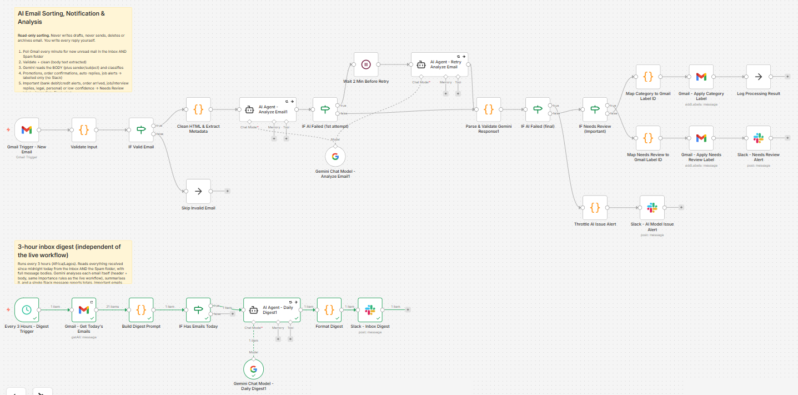
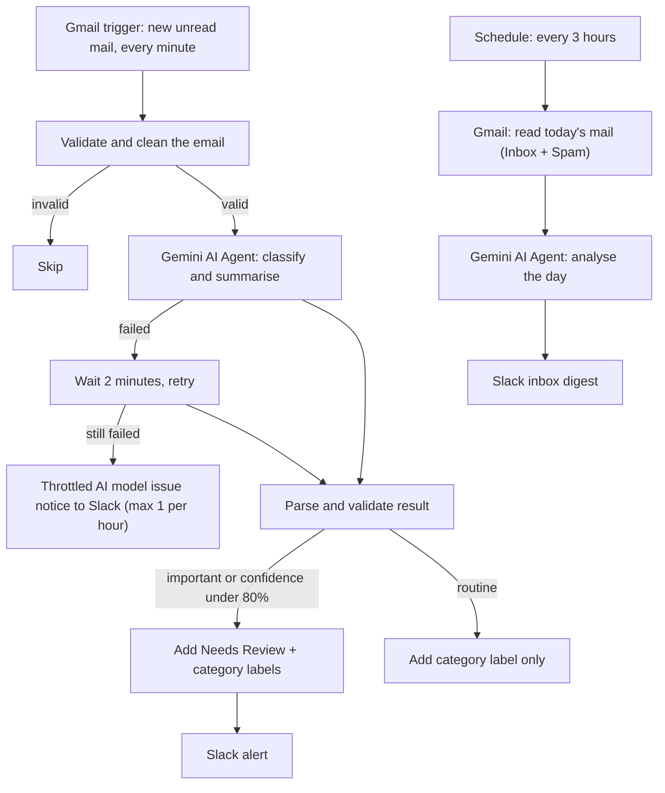
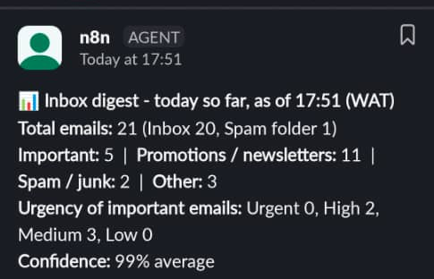

# AI Email Triage Assistant: Gmail Sorting, Slack Alerts and 3-Hour Digest

> Let AI read your inbox. Get a Slack alert only when something important arrives, and a summary of your day every 3 hours.

**Built with:** n8n · Google Gemini · Gmail · Slack · Docker **Type:** AI agent + scheduled digest (2 workflows in one file) **Status:** Working, running on self-hosted n8n

**Read-only by design.** It never sends, drafts, deletes or archives anything. You write every reply yourself.

## Architecture

The top flow handles each email as it arrives. The bottom flow is independent and summarises the whole day.

## What it does

| Step | What happens |
|---|---|
| 1. Watch | Checks Gmail every minute for new unread mail in the Inbox and the Spam folder (Trash is ignored). |
| 2. Clean | Checks the email has a sender, subject and body, strips HTML and signatures, and trims the body to 12,000 characters. |
| 3. Classify | Gemini reads the body (sender and subject are only weak hints) and returns a category, priority, summary, confidence score and the action you need to take. |
| 4. Route | Routine mail gets a category label and no notification. Important mail, or anything the AI is unsure about (confidence under 80%), gets a **Needs Review** label plus a Slack alert. |
| 5. Digest | Every 3 hours it re-reads the whole day's mail (Inbox and Spam) and sends one Slack summary with totals, urgency split, average confidence and a short analysis. |

### Categories
Sales, Support, Billing, Technical, Internal, Partnership, Newsletter, Spam, Other.

### Rules enforced in code (not left to the AI)
- Spam and newsletters can never trigger a Slack alert.
- A category the AI invents is replaced with `Other`; an invalid priority becomes `Low`.
- Important mail sitting in your Spam folder is flagged in the alert and in the digest.

### If the AI model fails
Failures are handled quietly instead of flooding Slack:
1. The AI step retries up to 3 times, 5 seconds apart.
2. If it still fails, the workflow waits 2 minutes and tries again (3 more tries).
3. If it still fails, that email is left untouched (no label, no per-email alert). The next 3-hour digest reads it again.
4. You get a single "AI model issue" Slack notice with the error and what to check. At most one per hour, and failures in between are counted into the next notice.

If the digest itself fails, you get one clear warning instead of a digest full of zeros.

## Example output

The 3-hour digest, received in Slack (top of the message, from a real test run):

The full message also lists each important email with its priority and the action needed, followed by promotions, spam and other mail.

## Is it really read-only?

The only Gmail actions in the workflow are **Get Many** (read) and **Add Labels**. There is no send, draft, delete or archive node. One thing to know: emails the AI classes as `Spam` get Gmail's built-in Spam label, which moves them to your Spam folder. This is reversible in Gmail.

## Tech stack

| Part | Tool |
|---|---|
| Automation | n8n (self-hosted in Docker) |
| AI | Google Gemini via the n8n AI Agent node (temperature 0.1, JSON output) |
| Email | Gmail (trigger, read, labels) |
| Notifications | Slack (direct message to you) |

## Setup

1. **Import** `ai-email-triage-workflow.json` into n8n (Workflows, Import from file).
2. **Credentials:** connect your own Gmail (OAuth2), Slack and Google Gemini (API key) credentials on the nodes that ask for them.
3. **Create Gmail labels** with these names: `Sales`, `Support`, `Billing`, `Technical`, `Internal`, `Partnership`, `Newsletter`, `Other`, `Needs Review`.
4. **Get the label IDs:** add a temporary Gmail node (Resource: Label, Operation: Get Many) and run it. Copy each ID (they look like `Label_123...`).
5. **Paste the IDs** into the two Code nodes named *Map Category to Gmail Label ID* and *Map Needs Review to Gmail Label ID*, replacing every `YOUR_LABEL_ID_...` placeholder. Spam uses Gmail's built-in `SPAM` label, so leave that one.
6. **Set your Slack username** by replacing `YOUR_SLACK_USERNAME` in the three Slack nodes.
7. **Check the Gemini model** on the two Gemini Chat Model nodes and pick a model your key can use.
8. **Set the timezone** of your n8n instance (the digest times and "today" use it; the template assumes Africa/Lagos).
9. **Activate** the workflow.

### Notes
- The hourly limit on "AI model issue" alerts only works while the workflow is **active**. In manual test runs it does not remember the previous alert.
- The AI prompt is written for a personal inbox: bank debit and credit alerts, delivery updates, job and interview replies, invoices and legal mail count as important. Edit the system message in *AI Agent - Analyze Email* and the rules text in *Build Digest Prompt* to fit your own needs. Keep the two in sync.
- The digest reads up to 100 emails per run.

## Limitations

- It runs on whatever machine hosts n8n. If n8n is off, nothing is processed. The 3-hour digest covers the whole day, so a stopped workflow catches up on the next run, but live alerts for that period are missed.
- Alerts go to a single Slack user.
- AI classification can be wrong. Treat labels as a helper, not a guarantee, and check your Spam folder yourself for anything critical.
- The workflow works on any n8n host (cloud or self-hosted). Once you add your own credentials it behaves the same.

## Security and privacy

- No API keys, tokens or personal IDs are included in this repository. Credentials, Slack username and Gmail label IDs were removed from the exported workflow.
- Email text is sent to the Google Gemini API for analysis. Get the mailbox owner's consent before running this on someone else's email, and check that your provider's terms suit the kind of mail involved.
- See [SECURITY.md](SECURITY.md) for how to report a problem.

## License

Released under the MIT License. Copyright (c) 2026 Osazuwa Micheal Kelvin. See [LICENSE](LICENSE).

## Contact

Built by **Osazuwa Micheal Kelvin**. For a live walkthrough, a custom version for your inbox, or help setting it up, reach out: [osazuwamichealkelvin@gmail.com](mailto:osazuwamichealkelvin@gmail.com) | +234 816 956 9058 | [LinkedIn](https://www.linkedin.com/in/micheal-osazuwa-kelvin14471230b)
